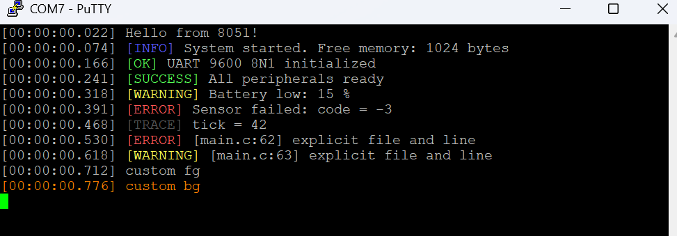

# 8051 (Keil C51) Example

Demo project for the 8051 branch of ElegantDebug.

## Hardware

- PRE-CHIN 51 experiment board, **STC89C52RC** @ **11.0592 MHz**
- On-board USB-to-UART bridge (CH340), 9600 baud 8N1

## Build

1. Open `ElegantDebug8051.uvproj` in Keil uVision 5 (C51 toolchain).
2. Press **F7**. Expected:

```
Program Size: data=80.1 xdata=72 code=3752
".\Objects\app" - 0 Error(s), 0 Warning(s).
```

3. Burn `Objects/app.hex`.

## STC-ISP settings

| Item | Value |
|---|---|
| MCU type | `STC89C52RC/LE52RC` |
| **Internal extended RAM** | **must be enabled** (the message buffer lives in `xdata`) |
| Baud rate | 9600 |

## Expected output

Use a terminal that renders ANSI escape codes (PuTTY, Windows Terminal,
MobaXterm). STC-ISP's built-in terminal shows the escape codes literally.



```
[00:00:00.022] Hello from 8051!
[00:00:00.074] [INFO] System started. Free memory: 1024 bytes
[00:00:00.166] [OK] UART 9600 8N1 initialized
[00:00:00.241] [SUCCESS] All peripherals ready
[00:00:00.318] [WARNING] Battery low: 15 %
[00:00:00.391] [ERROR] Sensor failed: code = -3
[00:00:00.468] [TRACE] tick = 42
[00:00:00.530] [ERROR] [main.c:62] explicit file and line
[00:00:00.618] [WARNING] [main.c:63] explicit file and line
[00:00:00.712] custom fg
[00:00:00.776] custom bg
```

The program prints once, 20 ms after reset, and then waits. Send **any
character** from the terminal (press Enter) to print the block again.

> Opening the serial port in PuTTY toggles DTR/RTS, which resets the board
> through the on-board auto-reset circuit, so the first block usually
> appears as soon as the terminal is opened.

## Resource usage

| Item | Used | Available |
|---|---|---|
| `data` | 80 B | 128 B |
| `xdata` | 72 B | 256 B (STC89C52RC internal extended RAM) |
| `code` | 3752 B | 8192 B |

## Limitations on this platform

- **`DEBUG_BUFFER_LEN` is 48**, not 256: the 128 bytes of internal RAM and
  the 256 bytes of xdata cannot hold the original per-function buffers.
- **The message buffer lives in `xdata`**, so internal extended RAM must be
  enabled when burning.
- **`error` / `warning` cannot capture `__FILE__` / `__LINE__` automatically.**
  Keil C51 has no variadic macros, so they are plain functions here. Use
  `debug_error_fileline()` / `debug_warning_fileline()` when the location
  is needed.
- **Integer constants passed to variadic functions** are stored in the
  smallest type that fits, while the callee reads a 16-bit `int`. Cast them:

```c
debug_info("value = %d", 1);        /* wrong on C51 */
debug_info("value = %d", (int)1);   /* correct */
```

  Variables and cast expressions work without a cast. This is a property
  of the Keil C51 compiler and affects `printf`/`sprintf` identically.
- **`%f` is not supported**: it would link the C51 float library (about
  1.5 KB of the 8 KB flash).