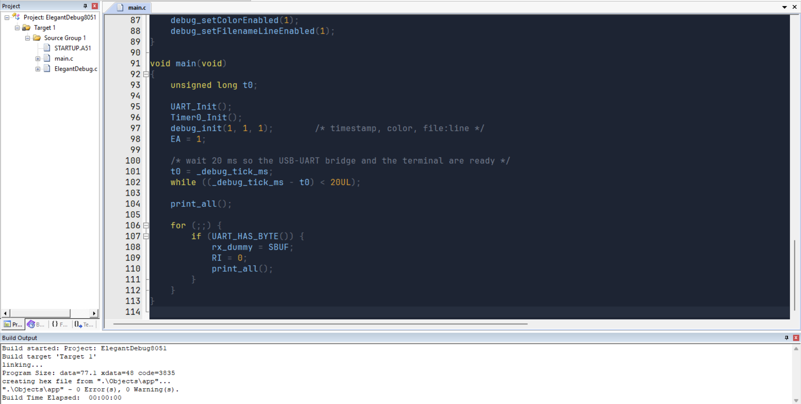

# 8051 (Keil C51) Example / 示例工程

Demo project for the 8051 branch of ElegantDebug.

## Hardware

- PRE-CHIN 51 experiment board, **STC89C52RC** @ **11.0592 MHz**
- On-board USB-to-UART bridge (CH340), 9600 baud 8N1
- Timer0 in mode 1 providing the 1 ms tick

## Build

1. Open `ElegantDebug8051.uvproj` in Keil uVision 5 (C51 toolchain).
2. Press **F7**. Expected:



3. Burn `Objects/app.hex`.

## STC-ISP settings

| Item | Value |
|---|---|
| MCU type | `STC89C52RC/LE52RC` |
| Internal extended RAM | **must be enabled** — `customTextColor()` / `customBgColor()` keep their 24-byte buffers in `xdata` |
| Baud rate | 9600 |

## Expected output

Use a terminal that renders ANSI escape codes (PuTTY, Windows Terminal,
MobaXterm). STC-ISP's built-in terminal shows the escape codes literally.


```
[00:00:00.022] Hello from 8051!
[00:00:00.074] [INFO] System started. Free memory: 1024 bytes
[00:00:00.166] [OK] UART 9600 8N1 initialized
[00:00:00.241] [SUCCESS] All peripherals ready
[00:00:00.318] [WARNING] Battery low: 15 %
[00:00:00.391] [ERROR] Sensor failed: code = -3
[00:00:00.468] [TRACE] tick = 42
[00:00:00.530] [ERROR] [main.c:75] explicit file and line
[00:00:00.618] [WARNING] [main.c:76] explicit file and line
[00:00:00.712] custom fg <ESC>[38;2;255;128;0m
[00:00:00.776] custom bg <ESC>[48;2;0;0;255m
[00:00:00.812] all three switches off
```

Line numbers in `[main.c:75]` come from `__LINE__`, so they follow the file
when it is edited. The last line is printed with the timestamp, color and
file:line switches all turned off.

The program prints once, 20 ms after reset, and then waits. Send **any
character** from the terminal (press Enter) to print the block again.

> Opening the serial port in PuTTY toggles DTR/RTS, which resets the board
> through the on-board auto-reset circuit, so the first block usually
> appears as soon as the terminal is opened.

## Resource usage

| Item | Used | Available |
|---|---|---|
| `data` | 76.1 B | 128 B |
| `xdata` | 48 B | 256 B (STC89C52RC internal extended RAM) |
| `code` | 3768 B | 8192 B |

About 1.3 KB of the code is the C51 printf machinery; the library's own static
data is 8 bytes.

## Why the receiver is polled, not interrupt-driven

The demo reads `RI` in the main loop and leaves `ES = 0`. The library's
default `putchar()` owns `TI` (it waits for `TI`, then clears it). If `ES` is
enabled, the serial ISR is entered on `TI` as well as `RI`, and then:

- not clearing `TI` in the ISR → the interrupt is re-requested forever, the
  main loop never advances;
- clearing `TI` in the ISR → `putchar()` waits for a flag nobody sets any
  more, and the first character hangs.

Both outcomes are fatal, so pick one owner of `TI`. For an interrupt-driven
receiver, define `DEBUG_EXTERNAL_PUTCHAR` and give the library your own
`putchar()` fed from a TX ring buffer.

## Limitations on this platform

- **`error` / `warning` cannot capture `__FILE__` / `__LINE__` automatically.**
  Keil C51 has no variadic macros, so they are plain functions here. Use
  `debug_error_fileline()` / `debug_warning_fileline()` when the location
  is needed.
- **Integer constants passed to variadic functions** are stored in the
  smallest type that fits, while the callee reads a 16-bit `int`. Cast them:

```c
debug_info("value = %d", 1);        /* wrong on C51 */
debug_info("value = %d", (int)1);   /* correct */
```

  Variables and cast expressions work without a cast. This is a property
  of the Keil C51 compiler and affects `printf`/`sprintf` identically.
- **`%f` is not supported**: it would link the C51 float library (about
  1.5 KB of the 8 KB flash).
- **Printing blocks.** At 9600 8N1 one byte takes about 1.04 ms, so the block
  above costs roughly 50 ms, during which the main loop is stopped.
