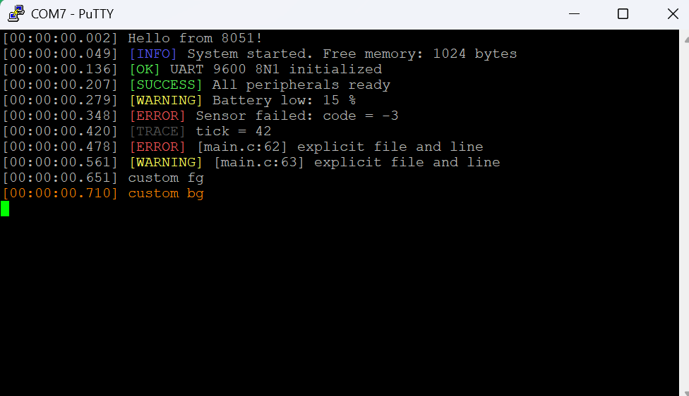

# 8051 (Keil C51) Example

Demo for the `USE_8051_C51` platform.

## Hardware

- Tested on a PRE-CHIN 51 experiment board with **STC89C52RC** @ **11.0592 MHz**
- On-board USB-to-UART bridge (CH340), 9600 baud 8N1

## Build

1. Open `ElegantDebug8051.uvproj` in Keil uVision 5 (C51 toolchain).
2. The project already sets `Define: USE_8051_C51` and
   `Include Paths: ..\..\Src-C`.
3. Press **F7**. Expected output:

```
Program Size: data=91.0 xdata=72 code=3992
".\Objects\app" - 0 Error(s), 0 Warning(s).
```

4. Burn `Objects/app.hex`.

## STC-ISP settings

- MCU type: `STC89C52RC/LE52RC`
- **Enable internal extended RAM** (required: the message buffers live in `xdata`)
- Baud rate 9600

## Expected output

Use a terminal that understands ANSI escape codes (PuTTY, Windows Terminal,
MobaXterm, or a serial monitor with ANSI enabled). STC-ISP's built-in
terminal does not render colors.



```
[00:00:00.002] Hello from 8051!
[00:00:00.049] [INFO] System started. Free memory: 1024 bytes
[00:00:00.136] [OK] UART 9600 8N1 initialized
[00:00:00.207] [SUCCESS] All peripherals ready
[00:00:00.279] [WARNING] Battery low: 15 %
[00:00:00.348] [ERROR] Sensor failed: code = -3
[00:00:00.420] [TRACE] tick = 42
[00:00:00.478] [ERROR] [main.c:62] explicit file and line
[00:00:00.561] [WARNING] [main.c:63] explicit file and line
[00:00:00.651] custom fg
[00:00:00.710] custom bg
```

## Resource usage

| Item | Used | Available |
|---|---|---|
| `data` | 91 B | 128 B |
| `xdata` | 72 B | 512 B (STC89C52 internal) |
| `code` | 3992 B | 8192 B |

## Notes and limitations

- **`xdata` is required.** The 128 bytes of internal RAM are not enough for
  message buffers, so `_dbg_msg` and `_ansi` are placed in `xdata`. Enable
  internal extended RAM (STC89C52) or provide external RAM.
- **64-byte message limit.** `_dbg_msg` is 64 bytes; longer messages are
  truncated.
- **`%f` is not supported.** Keil C51's float library would add ~1.5 KB of
  code and its own RAM usage.
- **The timestamp must be fed manually.** Call `debug_tick()` from a 1 ms
  timer interrupt, exactly like the RA FSP and TI MSPM0 platforms.
- **`debug_error()` / `debug_warning()` do not report `__FILE__` / `__LINE__`.**
  Keil C51 (C89) has no variadic macros, so on this platform they are plain
  functions instead of macros. `debug_error_fileline()` /
  `debug_warning_fileline()` still accept explicit file and line arguments.

## Why a dedicated implementation

Keil C51 differs from the ARM targets in ways that make the generic
implementation impractical on this platform:

| Constraint | Consequence |
|---|---|
| No `stdbool.h` / `stdint.h` | Types are provided by the header |
| No `inline` | `debug_tick()` becomes a macro |
| No variadic macros | `debug_error()` / `debug_warning()` become functions |
| No `snprintf` / `vsnprintf` | A minimal bounded formatter is provided |
| Locals are static, not stacked | Each function would keep its own buffers |
| C51's `printf` library alone needs ~57 B of RAM | The formatter is hand written instead |

The implementation therefore lives in its own `#if DEBUG_PLATFORM_8051`
block, while the code for the other platforms is compiled unchanged.

## Integer constants in variadic arguments

Keil C51 does **not** apply the default argument promotions required by
C89. An integer **constant** passed to a variadic function is stored in
the smallest type that can hold it, while the callee reads a 16-bit
`int`. `debug_info("value = %d", 1)` therefore prints the wrong number.

Add an explicit cast, or pass a variable:

```c
debug_info("value = %d", (int)1);   /* correct */
debug_info("value = %d", 1);        /* wrong on C51 */

int v = 1;
debug_info("value = %d", v);        /* correct */
```

This is a property of the Keil C51 compiler, not of this library. It
affects `printf`/`sprintf` in exactly the same way.
