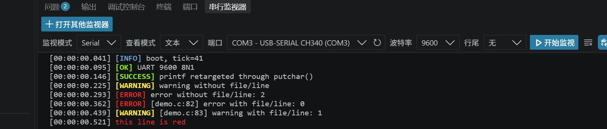

# Elegant Debug for 8051 Core (STC89C52RC)

> **Language/语言**: [English](README.md) | [简体中文](README-zh-CN.md)

## 简介

- 这是一个轻量的串口调试库，适配 8051 内核（已在 STC89C52RC 上用 Keil C51 验证），提供格式化日志输出功能。
- 特点：
  - 格式化日志
  - 可选的时间戳
  - 可选的 ANSI 颜色输出，包括完全自定义的24位颜色
  - 便捷的类型前缀（ERROR/WARNING/INFO/OK/SUCCESS）



STC89C52RC @ 11.0592 MHz 实机输出（VS Code 串口监视器，9600 8N1）：时间戳、类型前缀、`文件名:行号` 和 ANSI 颜色。

## 文件结构（仓库）

- C 版本放在 `Src-C/`

## 快速开始

- 环境：Keil C51（C90），SMALL 内存模式。实测 STC89C52RC @ 11.0592 MHz，串口 9600 8N1。
- `DEBUG_BUFFER_LEN`（默认 256）只为和主分支保持源码兼容。本移植版是边格式化边发送，**不会分配这么大的缓冲区**。
- API 名称、颜色宏、类型前缀和主分支保持一致；差异见下面的「需要注意」。

### 1. 把文件加入工程

将 `Src-C/ElegantDebug.h` 与 `Src-C/ElegantDebug.c` 添加到 Keil 工程，并确保 `ElegantDebug.c` 参与编译和链接。

### 2. 初始化串口

库**不配置波特率**，串口要应用自己初始化。11.0592 MHz 下 9600 8N1：

```c
void UART_Init(void)
{
    TMOD &= 0x0F;
    TMOD |= 0x20;       /* Timer1，模式2（8位自动重装） */
    TH1 = 0xFD;         /* 9600 @ 11.0592 MHz，SMOD = 0 */
    TL1 = 0xFD;
    SCON = 0x50;        /* 模式1，8位UART，REN = 1 */
    TR1 = 1;
}
```

### 3. 喂 1ms 时基

时间戳基于 `_debug_tick_ms`，在 1ms 定时器 ISR 里调用 `debug_tick()`。它是宏，展开成一条 32 位自增，没有函数调用开销：

```c
void Timer0_Init(void)
{
    TMOD &= 0xF0;
    TMOD |= 0x01;       /* Timer0，模式1（16位） */
    TH0 = 0xFC;         /* 1ms @ 11.0592 MHz：65536 - 922 = 0xFC66 */
    TL0 = 0x66;
    ET0 = 1;
    EA = 1;
    TR0 = 1;
}

void Timer0_ISR(void) interrupt 1
{
    TH0 = 0xFC;
    TL0 = 0x66;
    debug_tick();
}
```

### 4. 初始化并输出

```c
void main(void)
{
    UART_Init();
    debug_init(true, true, false);   /* 时间戳、颜色、文件名:行号 */
    Timer0_Init();

    debug_log("hello %d\r\n", 42);
    debug_info("system start\r\n");
    debug_ok("uart 9600 8N1\r\n");
    debug_error_fileline(__FILE__, __LINE__, "something wrong: %d\r\n", 3);

    while (1);
}
```

### 5. 发送路径与 `putchar`

库发出的每一个字节都走 `putchar()`，包括 `vprintf()` 产生的那部分格式化输出。

- **默认**：`ElegantDebug.c` 自己定义 `char putchar(char c)`，写 `SBUF` 后轮询 `TI`。
- **工程里已经有 `putchar`**（printf 重定向的常见做法）：在**工程的 C51 预处理符号**里加 `DEBUG_EXTERNAL_PUTCHAR`（Project -> Options for Target -> C51 -> Preprocessor Symbols -> Define）。`ElegantDebug.c` 看到这个宏就不再定义 `putchar`，所有输出走你自己的。

> ⚠️ 只在 `main.c` 里 `#define` 不够：`ElegantDebug.c` 是单独编译的，照样会定义 `putchar`，链接时报 `L104: MULTIPLE PUBLIC DEFINITIONS`，符号 `PUTCHAR`。

> ⚠️ **TI 冲突**：默认 `putchar` 会等 `TI` 然后清零。如果工程的中断里也清 `TI`（8051 工程很常见），两边会抢，轮询循环可能卡死。这类工程必须用 `DEBUG_EXTERNAL_PUTCHAR`，在自己的 `putchar` 里发送。

### 6. 资源占用

用 Keil C51 v9.54 / BL51 V6.22、SMALL 模式实测，库加一个调用全部公开函数的示例程序，链接参数 `RAMSIZE(256)`：

| 区域 | 占用 |
|---|---|
| DATA | 82 字节（含寄存器组 0 和 1 字节栈段） |
| XDATA | 48 字节（两个 24 字节的自定义颜色缓冲） |
| CODE | 3863 字节（约 3.8 KB） |

C51 的 printf 机制是 8051 上做格式化输出的固定代价：`?PR?PRINTF`（860 字节）加 `?C?LIB_CODE`（450 字节）合计约 1.3 KB CODE，printf 的 `?BYTE` 参数块占 20 字节 DATA（只调用 printf 的测试程序链接结果是 `data=30`、`code=1069`）。库自身的静态数据是 8 字节。RAM 紧张就把 `customTextColor()` / `customBgColor()` 里的 `xdata` 缓冲挪走或改小。

### 7. 可变参数函数的 DATA 开销

C51 会给**每一个**可变参数函数分配 18~26 字节的 `?BYTE` 参数块。SMALL 模式下这些块放在 DATA 里。BL51 只对调用树内的函数做参数块覆盖；应用没调用的函数会独占自己的块。九个入口全部没被调用时，光参数块就要约 190 字节，链接直接报 `L107: ADDRESS SPACE OVERFLOW`。

所以 `ElegantDebug.c` 在 `_debug_keep_all()` 里引用了每一个入口（由恒为 false 的 `_debug_link_all` 守着，不会真的打印）。这样整个 API 都进入 BL51 的调用树，参数块会互相覆盖，不管应用实际调用哪几个函数。你不需要为了让工程链接通过去故意调用用不到的函数。

如果从库里删掉某个入口，记得把 `_debug_keep_all()` 里对应的调用一起删掉。

### 示例

```c
/* 目标：STC89C52RC @ 11.0592 MHz，串口 9600 8N1，Keil C51 SMALL 模式 */
#include <REG52.H>
#include "ElegantDebug.h"

void UART_Init(void)
{
    TMOD &= 0x0F;
    TMOD |= 0x20;
    TH1 = 0xFD;
    TL1 = 0xFD;
    SCON = 0x50;
    TR1 = 1;
}

void Timer0_Init(void)
{
    TMOD &= 0xF0;
    TMOD |= 0x01;
    TH0 = 0xFC;
    TL0 = 0x66;
    ET0 = 1;
    EA = 1;
    TR0 = 1;
}

void Timer0_ISR(void) interrupt 1
{
    TH0 = 0xFC;
    TL0 = 0x66;
    debug_tick();
}

void main(void)
{
    int err_code = 2;   /* 先存 int，再传给 %d，见「需要注意」 */

    UART_Init();
    debug_init(true, true, false);   /* 颜色需要终端支持 ANSI */
    Timer0_Init();

    debug_log("ElegantDebug 8051 port\r\n");
    debug_info("boot, tick=%u\r\n", (unsigned int)_debug_tick_ms);
    debug_ok("UART 9600 8N1\r\n");
    debug_success("printf retargeted through putchar()\r\n");
    debug_warning("warning without file/line\r\n");
    debug_error("error without file/line: %d\r\n", err_code);

    debug_setFilenameLineEnabled(true);
    debug_error_fileline(__FILE__, __LINE__, "error with file/line: %d\r\n", err_code);
    debug_warning_fileline(__FILE__, __LINE__, "warning with file/line\r\n");
    debug_setFilenameLineEnabled(false);

    /* 自定义颜色：用一对 %s 包住颜色宏和清除宏 */
    debug_log("%sthis line is red%s\r\n", COLOR_RED, CLR);

    while (1);
}
```

## API

- `void debug_init(bool enable_timestamp, bool enable_color, bool enable_filename_line);`
  - 初始化库，必须先调用。串口由应用初始化；本移植版不接收串口句柄。
- `debug_tick()`
  - **宏**（C51 没有 `inline`），展开为 `_debug_tick_ms++`。在 1ms 定时器 ISR 中调用以递增内部毫秒计数器，用于时间戳功能。
- `void debug_log(const char* format, ...);`
  - 原始格式化输出（无前缀）。
- `void debug_logWithType(const char* type, const char* style, const char* format, ...);`
  - 自定义前缀和样式的输出（例如 `"\033[91m"` + `"[ CUSTOM ]"`）。
- 便捷类型输出（无文件名行号）：
  - `void debug_error(const char* format, ...);`
  - `void debug_warning(const char* format, ...);`
  - `void debug_ok(const char* format, ...);`
  - `void debug_success(const char* format, ...);`
  - `void debug_info(const char* format, ...);`
- 带文件名行号的输出（**8051 上需要显式传 `__FILE__` / `__LINE__`**）：
  - `void debug_error_fileline(const char* file, int line, const char* format, ...);`
  - `void debug_warning_fileline(const char* file, int line, const char* format, ...);`
- 运行时设置：
  - `void debug_setTimestampEnabled(bool enabled);`
  - `void debug_setColorEnabled(bool enabled);`
  - `void debug_setFilenameLineEnabled(bool enabled);`

### 需要注意

- C51（C90）**没有可变参数宏**，所以 `debug_error()` / `debug_warning()` 不能像主分支那样自动获取调用位置。需要文件名行号时用 `debug_error_fileline(__FILE__, __LINE__, ...)`。
- `vprintf()` 在 C51 里使用静态数据区，**不可重入**。不要在中断里打日志，也不要在主循环和中断里同时打。
- 库**不会自动加行尾**，请在格式串里自己写 `\r\n`。
- **一次调用别传太多参数**：C51 为每个可变参数函数只留约 18 字节的 `?BYTE` 空间，一个 `char*` 占 3 字节。参数超了会覆盖相邻变量（输出乱码或死机）。建议每次调用控制在 4~5 个参数以内，长行拆开打。
- **小整数字面量先存进 `int` 再传给 `%d`/`%u`**：C51 把小的字面量按一字节传递，而 `%d` 读两字节，`2` 可能打印成 `553`。写成 `int code = 2; debug_log("%d", code);`。
- C51 的 printf 支持 `%d`、`%u`、`%x`、`%c`、`%s`、`%lu` 和宽度/精度，但**浮点非常吃 Flash**。避免 `%f`，把数值乘 10^n 后用整数打印。
- `DEBUG_BUFFER_LEN` 在本移植版中不分配内存：输出边格式化边发送，所以再长的日志也不会被截断，也不会有缓冲区溢出。
- 本分支没有平台条件编译。`DEBUG_EXTERNAL_PUTCHAR` 只决定 `putchar` 由谁提供。

### 关于ANSI转义码

库中的颜色和样式宏均为 ANSI 转义码，如果终端不支持，可以通过运行时设置关闭颜色输出，并停用%s修饰的操作。

要为你的输出字符串设置自定义颜色和样式，请用一对 `%s` 来包裹颜色/样式宏和用以清除颜色/样式的宏。例如：

```c
debug_log("Hello World! %sI am RED!%s %s%sI am italic and GREEN!%s Now i cleared italic style but still GREEN.%s\n",
COLOR_RED, CLR_TEXT_COLOR, ITALIC, COLOR_GREEN, CLR_ITALIC, CLR);
```

对于24位自定义颜色，请使用 `COLOR_CUSTOM(r,g,b)` 和 `BG_COLOR_CUSTOM(r,g,b)` 宏，其中 `r`、`g`、`b` 为0~255之间的整数。这些宏现在内部调用了运行时辅助函数，因此可以使用变量而非字面常量传递颜色值。

关于 ANSI 转义码的更多信息，请参考：[ANSI escape code - Handwiki](https://handwiki.org/wiki/ANSI_escape_code)

## 常见问题与排查

- **完全没有输出**
  - 检查串口初始化、9600 波特率、`TR1` 和共地。
  - 检查是否调用了 `debug_init()`。
  - 用了 `DEBUG_EXTERNAL_PUTCHAR` 时，确认自己的 `putchar` 真的往 `SBUF` 写。
- **输出卡住 / 只出来一个字节**
  - 串口中断里清了 `TI`，和默认 `putchar` 抢。改用 `DEBUG_EXTERNAL_PUTCHAR`。
- **`L104: MULTIPLE PUBLIC DEFINITIONS`，符号 `PUTCHAR`**
  - 工程里已经有 `putchar`，但 C51 预处理符号里没定义 `DEBUG_EXTERNAL_PUTCHAR`。
- **`L107: ADDRESS SPACE OVERFLOW`**
  - 只调 printf 的工程约 30 字节 DATA，库加示例是 82 字节；先看工程本身离 128 字节还有多少余量。
  - 检查 `_debug_keep_all()` 里的调用还在不在。
  - 把大数组挪到 `idata` 或 `xdata`。
- **`L103: EXTERNAL ATTRIBUT DO NOT MATCH PUBLIC`**
  - 库和工程的存储模式不一致。`_debug_tick_ms` 显式声明为 `data`，工程其余部分保持 SMALL 模式。
- **时间戳一直是 0**
  - 定时器 ISR 里没有调用 `debug_tick()`。
- **传字面量给 `%d` 输出乱码**
  - C51 把小整数字面量按一字节传递，而 `%d` 读两字节，`2` 可能打印成 `553`。先存进 `int`：`int code = 2; debug_log("%d", code);`。

## 更新日志

### v1.0 (2025-12-10)

- **初始发布**: STM32 Elegant Debug 库首次发布
- **功能**: 格式化日志输出、时间戳、ANSI颜色、类型前缀等基础功能
- **支持**: C和C++双版本，适配STM32 HAL库

### v1.1 (2025-12-11)

- **新增**: 支持在错误和警告信息中显示文件名和行号
  - C版本：通过 `debug_setFilenameLineEnabled(true)` 启用，`debug_error()` 和 `debug_warning()` 自动包含文件名行号
  - C++版本（C++20及以上）：通过 `setFilenameLineEnabled(true)` 启用，支持 `std::source_location`
- **新增**: 支持更多的ANSI颜色和样式
- **改进**: 更新API文档，更准确地反映实际功能

### v1.2 (2026-02-22)

- **新增**: 此库现在支持USB-CDC输出。要使用此功能，只需打开MX配置中的USB_DEVICE中间件，将USB设置为CDC类。然后在此库头文件中将 `USB_AS_DEBUG_PORT` 定义为 `1` 即可。

### v1.3 (2026-03-01)

- **改进**: 现在自定义颜色可以传入运行时变量。这支持了更多样的用法，例如根据数字大小设置对应的渐变颜色（如简介处图）

### v1.4 (2026-07-16)

- **新增**: 支持 Renesas RA FSP 平台（`USE_RA_FSP` 宏）
  - SCI UART 输出
  - 独立的时间戳计数器 `_debug_tick_ms`，用户从定时器 ISR 喂入 C 版本 `debug_tick()` / C++ 版本 `ElegantDebug::tick()` 内联函数
- **新增**: 平台选择机制（`#if defined(USE_STM32_HAL)` / `#elif defined(USE_RA_FSP)`）条件编译

### v1.5 (2026-07-24)

- **新增**: 支持 TI MSPM0 DL 平台（`USE_TI_MSPM0_DL` 宏）
  - 时间戳与 RA 平台共用 `_debug_tick_ms`，用户从 SysTick ISR 喂入
  - 平台选择机制扩展至三个平台条件编译

### v1.6 (2026-08-09)

- **改进**: v1.4 和 v1.5 版本中，RA FSP 平台中如连续发送log（中间无手动延时），会导致发送的数据丢失。针对 RA FSP 的非阻塞发送函数，添加了`onTxComplete()`函数，此函数在 TX 完成回调中必须调用来更新发送完成标志。

### v1.6 - 8051 (2026-11-15)

- **新分支**: 当前分支基于主分支产生。特用于 STC89C52RC 或其他 8051 内核的单片机
- **实现说明**:
  - `debug_init()` 接收三个开关（时间戳 / 颜色 / 文件名行号），串口由应用初始化
  - 默认 `putchar()` 写 `SBUF` 并轮询 `TI`；工程已有 `putchar` 时定义 `DEBUG_EXTERNAL_PUTCHAR`
  - 输出经 `vprintf()` + `putchar()` 流式发送，不分配消息缓冲，`DEBUG_BUFFER_LEN` 不占 RAM
  - `debug_tick()` 改为宏（C51 没有 `inline`）；`_getTick()` 连读两次 32 位计数，避免被 ISR 撕裂
  - `debug_error()` / `debug_warning()` 是普通可变参数函数（C51 没有可变参数宏），需要 `__FILE__` / `__LINE__` 时用 `*_fileline()` 变体
  - 时间戳和十进制数字不走 `printf`，避免每个调用点再多一块 DATA 参数区
  - `_debug_keep_all()` 引用全部入口，让 BL51 覆盖未使用函数的可变参数块，避免 DATA 溢出
  - 补充了快速开始、资源占用和常见问题排查文档

## 其他

> 此库灵感最初源于学长Zodiak_Jealously的提议 ;p

WilliTourt 2025.12.10 initial release | willitourt@foxmail.com

欢迎提交 PR 和 Issue！！
