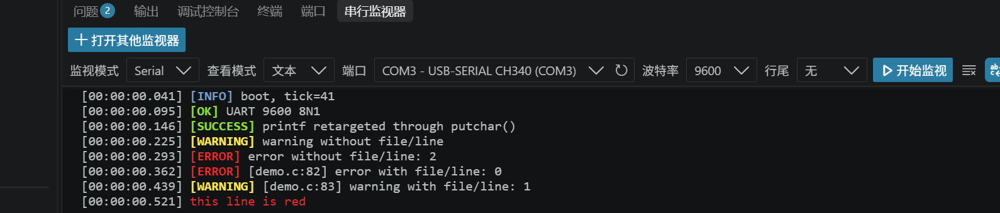

# Elegant Debug for 8051 Core (STC89C52RC)

> **Language/语言**: [English](README.md) | [简体中文](README-zh-CN.md)

## Introduction

- A lightweight serial debug library for 8051-core MCUs (verified on STC89C52RC with Keil C51), providing formatted log output.
- Features:
  - Formatted output
  - Optional timestamp
  - Optional ANSI color output, including fully customizable 24-bit colors
  - Convenient type prefixes (ERROR/WARNING/INFO/OK/SUCCESS)



Captured on an STC89C52RC @ 11.0592 MHz (VS Code Serial Monitor, 9600 8N1): timestamps, type prefixes, filename:line and ANSI colors.

## Repository layout

- C implementation is in `Src-C/`
- Keil example project (STC89C52RC, uvproj + STARTUP.A51) is in `Examples/8051/`

## Quick Start

- Environment: Keil C51 (C90), SMALL memory model. Tested on STC89C52RC @ 11.0592 MHz, UART 9600 8N1.
- The API names, color macros and type prefixes are the same as on the main branch; the differences are listed under Notes below.

### 1. Add the files to your project

Add `Src-C/ElegantDebug.h` and `Src-C/ElegantDebug.c` to the Keil project and make sure `ElegantDebug.c` is compiled and linked.

### 2. Initialize the UART

The library **does not configure the baud rate**; the UART must be initialized by the application. 9600 8N1 at 11.0592 MHz:

```c
void UART_Init(void)
{
    TMOD &= 0x0F;
    TMOD |= 0x20;       /* Timer1, mode 2 (8-bit auto reload) */
    TH1 = 0xFD;         /* 9600 @ 11.0592 MHz, SMOD = 0 */
    TL1 = 0xFD;
    SCON = 0x50;        /* mode 1, 8-bit UART, REN = 1 */
    TR1 = 1;
}
```

### 3. Feed a 1 ms tick

The timestamp is based on `_debug_tick_ms`. Call `debug_tick()` from a 1 ms timer ISR; it is a macro that expands to a single 32-bit increment, so there is no call overhead:

```c
void Timer0_Init(void)
{
    TMOD &= 0xF0;
    TMOD |= 0x01;       /* Timer0, mode 1 (16-bit) */
    TH0 = 0xFC;         /* 1 ms @ 11.0592 MHz: 65536 - 922 = 0xFC66 */
    TL0 = 0x66;
    ET0 = 1;
    EA = 1;
    TR0 = 1;
}

void Timer0_ISR(void) interrupt 1
{
    TH0 = 0xFC;
    TL0 = 0x66;
    debug_tick();
}
```

### 4. Initialize and log

```c
void main(void)
{
    UART_Init();
    debug_init(true, true, false);   /* timestamp, color, filename:line */
    Timer0_Init();

    debug_log("hello %d\r\n", 42);
    debug_info("system start\r\n");
    debug_ok("uart 9600 8N1\r\n");
    debug_error_fileline(__FILE__, __LINE__, "something wrong: %d\r\n", 3);

    while (1);
}
```

### 5. TX path and `putchar`

Everything the library sends goes through `putchar()`, including the formatted output produced by `vprintf()`.

- **Default**: `ElegantDebug.c` defines `char putchar(char c)`, which writes `SBUF` and polls `TI`.
- **Your project already redirects `putchar`** (the usual way to retarget printf): add `DEBUG_EXTERNAL_PUTCHAR` to the **project's C51 preprocessor symbols** (Project -> Options for Target -> C51 -> Preprocessor Symbols -> Define). `ElegantDebug.c` then sees the macro, does not define `putchar`, and all output goes through yours.

> ⚠️ A `#define` in `main.c` alone is not enough: `ElegantDebug.c` is compiled separately and will still define `putchar`, producing `L104: MULTIPLE PUBLIC DEFINITIONS` on symbol `PUTCHAR`.

> ⚠️ **TI conflict**: the default `putchar` waits for `TI` and then clears it. If your UART ISR also clears `TI` (common in 8051 projects), the two will fight and the polling loop can hang. Such projects must use `DEBUG_EXTERNAL_PUTCHAR` and do the transmission in their own `putchar`.

### 6. Memory footprint

Measured with Keil C51 v9.54 / BL51 V6.22, SMALL model, the library plus a demo that calls every public function, linked with `RAMSIZE(256)`:

| Area | Usage |
|---|---|
| DATA | 82 bytes (including register bank 0 and the 1-byte stack segment) |
| XDATA | 48 bytes (two 24-byte custom-color buffers) |
| CODE | 3863 bytes (about 3.8 KB) |

The C51 printf machinery is the fixed price of formatted output on an 8051: `?PR?PRINTF` (860 B) and `?C?LIB_CODE` (450 B) together take about 1.3 KB of CODE, and printf's `?BYTE` block is 20 bytes of DATA (a printf-only test program links at `data=30`, `code=1069`). The library's own static data is 8 bytes. If RAM is tight, move or shrink the `xdata` buffers in `customTextColor()` / `customBgColor()`.

Those 48 bytes of XDATA live in **extended RAM**. An STC89C52RC has 256 bytes of internal extended RAM, but you must **tick "内部扩展RAM可用" in STC-ISP when flashing**; without it that address range reads back as `0xFF`, so the color strings turn into garbage or never terminate. If you would rather not touch that switch, shrink or delete the two color buffers.

### 6.1 Printing costs time

At 9600 8N1 one byte takes about **1.04 ms**, so a 40-character line costs roughly **42 ms**. `debug_log()` transmits by polling, and the main loop is stopped for the whole call — one log line is one 42 ms delay. Therefore:

- Keep lines short. Print a few numbers, not a paragraph.
- Do not print from timer callbacks or high-rate interrupts.
- One long line per second stalls the main loop once per second; this matters in any project that forbids delays in the main loop.

### 7. About the DATA cost of variadic functions

C51 allocates an 18..26 byte `?BYTE` parameter block for **every** variadic function. In the SMALL model those blocks live in DATA. BL51 only overlays blocks of functions that are part of the call tree; a function your application never calls keeps its own block. With all nine variadic entry points unused, the blocks alone need about 190 bytes and the link fails with `L107: ADDRESS SPACE OVERFLOW`.

`ElegantDebug.c` therefore references every entry point from `_debug_keep_all()` (guarded by `_debug_link_all`, which is always false, so nothing is printed). This puts the whole API into the BL51 call tree, so the parameter blocks overlay regardless of which functions your application calls. You do not need to call unused entry points just to make the project link.

If you delete entry points from the library, remove the matching calls from `_debug_keep_all()`.

### Example

```c
/* Target: STC89C52RC @ 11.0592 MHz, UART 9600 8N1, Keil C51 SMALL model */
#include <REG52.H>
#include "ElegantDebug.h"

void UART_Init(void)
{
    TMOD &= 0x0F;
    TMOD |= 0x20;
    TH1 = 0xFD;
    TL1 = 0xFD;
    SCON = 0x50;
    TR1 = 1;
}

void Timer0_Init(void)
{
    TMOD &= 0xF0;
    TMOD |= 0x01;
    TH0 = 0xFC;
    TL0 = 0x66;
    ET0 = 1;
    EA = 1;
    TR0 = 1;
}

void Timer0_ISR(void) interrupt 1
{
    TH0 = 0xFC;
    TL0 = 0x66;
    debug_tick();
}

void main(void)
{
    int err_code = 2;   /* store in an int before passing to %d, see Notes */

    UART_Init();
    debug_init(true, true, false);   /* color needs a terminal that parses ANSI */
    Timer0_Init();

    debug_log("ElegantDebug 8051 port\r\n");
    debug_info("boot, tick=%u\r\n", (unsigned int)_debug_tick_ms);
    debug_ok("UART 9600 8N1\r\n");
    debug_success("printf retargeted through putchar()\r\n");
    debug_warning("warning without file/line\r\n");
    debug_error("error without file/line: %d\r\n", err_code);

    debug_setFilenameLineEnabled(true);
    debug_error_fileline(__FILE__, __LINE__, "error with file/line: %d\r\n", err_code);
    debug_warning_fileline(__FILE__, __LINE__, "warning with file/line\r\n");
    debug_setFilenameLineEnabled(false);

    /* Custom colors: wrap the color macro and the clear macro in a pair of %s */
    debug_log("%sthis line is red%s\r\n", COLOR_RED, CLR);

    while (1);
}
```

## API

- `void debug_init(bool enable_timestamp, bool enable_color, bool enable_filename_line);`
  - Initialize the library; must be called before any other function. The UART is initialized by the application; this port takes no UART handle.
- `debug_tick()`
  - **Macro** (C51 has no `inline`), expands to `_debug_tick_ms++`. Call it from a 1 ms timer ISR to advance the millisecond counter used by the timestamp.
- `void debug_log(const char* format, ...);`
  - Raw formatted output (no prefix).
- `void debug_logWithType(const char* type, const char* style, const char* format, ...);`
  - Output with a custom prefix and style (for example `"\033[91m"` + `"[ CUSTOM ]"`).
- Type helpers (no filename/line):
  - `void debug_error(const char* format, ...);`
  - `void debug_warning(const char* format, ...);`
  - `void debug_ok(const char* format, ...);`
  - `void debug_success(const char* format, ...);`
  - `void debug_info(const char* format, ...);`
- With filename and line (on 8051 you must pass `__FILE__` / `__LINE__` explicitly):
  - `void debug_error_fileline(const char* file, int line, const char* format, ...);`
  - `void debug_warning_fileline(const char* file, int line, const char* format, ...);`
- Runtime setters:
  - `void debug_setTimestampEnabled(bool enabled);`
  - `void debug_setColorEnabled(bool enabled);`
  - `void debug_setFilenameLineEnabled(bool enabled);`

### Notes

- C51 (C90) has **no variadic macros**, so `debug_error()` / `debug_warning()` cannot capture the call site automatically as they do on the main branch. Use `debug_error_fileline(__FILE__, __LINE__, ...)` when the location is needed.
- `vprintf()` uses a static data group in C51 and is **not reentrant**. Do not log from an ISR, and do not log from both the main loop and an ISR at the same time.
- The library does **not** append a line ending; put `\r\n` in your format string.
- **Do not pass too many arguments to one call**: C51 reserves only about 18 bytes of `?BYTE` space for the variadic arguments of each function, and a `char*` takes 3 bytes. Extra arguments overwrite adjacent variables (garbage output or a crash). Keep each call to 4..5 arguments and split long lines.
- **Store small integer literals in `int` variables before passing them to `%d`/`%u`**: C51 passes a small literal as one byte while `%d` reads two, so `2` can print as `553`. Write `int code = 2; debug_log("%d", code);`.
- C51's printf supports `%d`, `%u`, `%x`, `%c`, `%s`, `%lu` and width/precision, but **floating point is very expensive in Flash**. Avoid `%f`; scale the value by 10^n and print an integer instead.
- Output is formatted and transmitted on the fly, so a long log is never truncated and cannot overflow a message buffer.
- There is no platform conditional compilation on this branch. `DEBUG_EXTERNAL_PUTCHAR` only selects who provides `putchar`.

### About ANSI Escape Codes

The color and style macros in the library are ANSI escape codes. If your terminal doesn't support them, you can disable color output at runtime and avoid using the `%s` formatting operations.

To set custom colors and styles for your output strings, wrap the color/style macros and the clear macros with a pair of `%s` placeholders. For example:

```c
debug_log("Hello World! %sI am RED!%s %s%sI am italic and GREEN!%s Now i cleared italic style but still GREEN.%s\n",
COLOR_RED, CLR_TEXT_COLOR, ITALIC, COLOR_GREEN, CLR_ITALIC, CLR);
```

For 24-bit custom colors, use the `COLOR_CUSTOM(r,g,b)` and `BG_COLOR_CUSTOM(r,g,b)` macros, where `r`, `g`, `b` are integers between 0 and 255. These macros call helper functions internally, so the red/green/blue values can be supplied from variables instead of literal constants.

For more information about ANSI escape codes, refer to: [ANSI escape code - Handwiki](https://handwiki.org/wiki/ANSI_escape_code)

## Troubleshooting

- **No output**
  - Check the UART init, 9600 baud, `TR1`, and a common ground.
  - Check that `debug_init()` is called.
  - With `DEBUG_EXTERNAL_PUTCHAR`, check that your `putchar` really writes to `SBUF`.
- **Output hangs / only one byte appears**
  - The UART ISR clears `TI`, fighting the default `putchar`. Use `DEBUG_EXTERNAL_PUTCHAR`.
- **`L104: MULTIPLE PUBLIC DEFINITIONS`, symbol `PUTCHAR`**
  - The project already defines `putchar` but `DEBUG_EXTERNAL_PUTCHAR` is not defined in the C51 preprocessor symbols.
- **`L107: ADDRESS SPACE OVERFLOW`**
  - printf alone links at about 30 bytes of DATA and the library plus the demo at 82; check how close the project already is to 128 bytes.
  - Check that the `_debug_keep_all()` calls are still present.
  - Move large arrays/buffers to `idata` or `xdata`.
- **`L103: EXTERNAL ATTRIBUT DO NOT MATCH PUBLIC`**
  - The library and the project use different memory models. `_debug_tick_ms` is explicitly `data`; keep the rest of the project in the SMALL model.
- **Timestamp stays at 0**
  - `debug_tick()` is not called from the timer ISR.
- **Garbage output when passing literals to `%d`**
  - C51 passes a small integer literal as one byte while `%d` reads two, so `2` can print as `553`. Store the value in an `int` first: `int code = 2; debug_log("%d", code);`.
- **Custom colors print garbage, or a line never terminates**
  - "内部扩展RAM可用" was not ticked in STC-ISP, so the 48 bytes of `xdata` read back as `0xFF` and the string has no terminator.

## Changelog

### v1.0 (2025-12-10)

- **Initial release**: First release of STM32 Elegant Debug library
- **Features**: Formatted log output, timestamp, ANSI colors, type prefixes and other basic functionality
- **Support**: Dual C and C++ versions, compatible with STM32 HAL library

### v1.1 (2025-12-11)

- **New**: Support for displaying filename and line number in error and warning messages
  - C version: Enable with `debug_setFilenameLineEnabled(true)`, `debug_error()` and `debug_warning()` automatically include filename and line number
  - C++ version (C++20 and above): Enable with `setFilenameLineEnabled(true)`, supports `std::source_location`
- **New**: Supports more ANSI colors and styles
- **Improvement**: Updated API documentation to accurately reflect actual functionality

### v1.2 (2026-02-22)

- **New**: This library now supports USB-CDC output. To use this feature, simply enable the USB_DEVICE middleware in your MX configuration and set USB to CDC class. Then define `USB_AS_DEBUG_PORT` to `1` in the library's header file.

### v1.3 (2026-03-01)

- **Improvement**: Custom colors can now accept runtime variables. This enables more diverse usage, such as setting gradient colors based on numeric values (as shown in the example image).

### v1.4 (2026-07-16)

- **New**: Renesas RA FSP platform supported (use `USE_RA_FSP` macro)
  - SCI UART output (both SCI and SCI_B supported)
  - Independent tick counter `_debug_tick_ms`, fed from user timer ISR: C `debug_tick()` / C++ `ElegantDebug::tick()` inline functions
- **New**: Platform selection mechanism (`#if defined(USE_STM32_HAL)` / `#elif defined(USE_RA_FSP)`), conditional compilation

### v1.5 (2026-07-24)

- **New**: TI MSPM0 DL platform supported (use `USE_TI_MSPM0_DL` macro)
  - The timestamp shares `_debug_tick_ms` with the RA platform, feeds in from SysTick ISR
  - The platform selection mechanism is extended to three platform conditional compilations

### v1.6 (2026-08-09)

- **Improvement**: In v1.4 and v1.5, consecutive log calls on the RA FSP platform (without manual delays between them) would cause data loss due to the non-blocking TX behaviour. Added `onTxComplete()` / `debug_onTxComplete()` which must be called from the TX complete UART callback to signal that the transmission has finished.

### v1.6 - 8051 (2026-11-15)

- **New branch**: based on the main branch, for STC89C52RC and other 8051-core MCUs
- **Implementation notes**:
  - `debug_init()` takes three flags (timestamp / color / filename:line); the UART is initialized by the application
  - The default `putchar()` writes `SBUF` and polls `TI`; define `DEBUG_EXTERNAL_PUTCHAR` if the project already has one
  - Output is streamed through `vprintf()` and `putchar()`; no message buffer is allocated
  - `debug_tick()` is a macro (C51 has no `inline`); `_getTick()` reads the 32-bit tick twice to avoid a torn value from the ISR
  - `debug_error()` / `debug_warning()` are plain variadic functions, since C51 has no variadic macros; use the `*_fileline()` variants for `__FILE__` / `__LINE__`
  - Timestamp and decimal numbers are sent without `printf` to avoid an extra DATA parameter block per call site
  - `_debug_keep_all()` references every entry point so BL51 overlays the variadic parameter blocks of unused functions instead of overflowing DATA
  - Added quick start, memory usage and troubleshooting documentation

## Other

> This project was inspired by a suggestion from Zodiak_Jealously ;p

WilliTourt 2025.12.10 initial release | willitourt@foxmail.com

Contributions and PRs welcome!!
